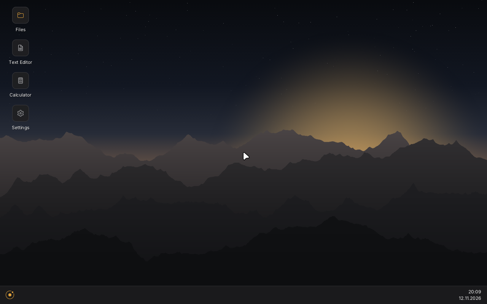
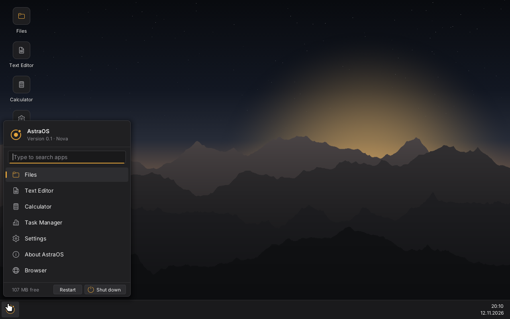
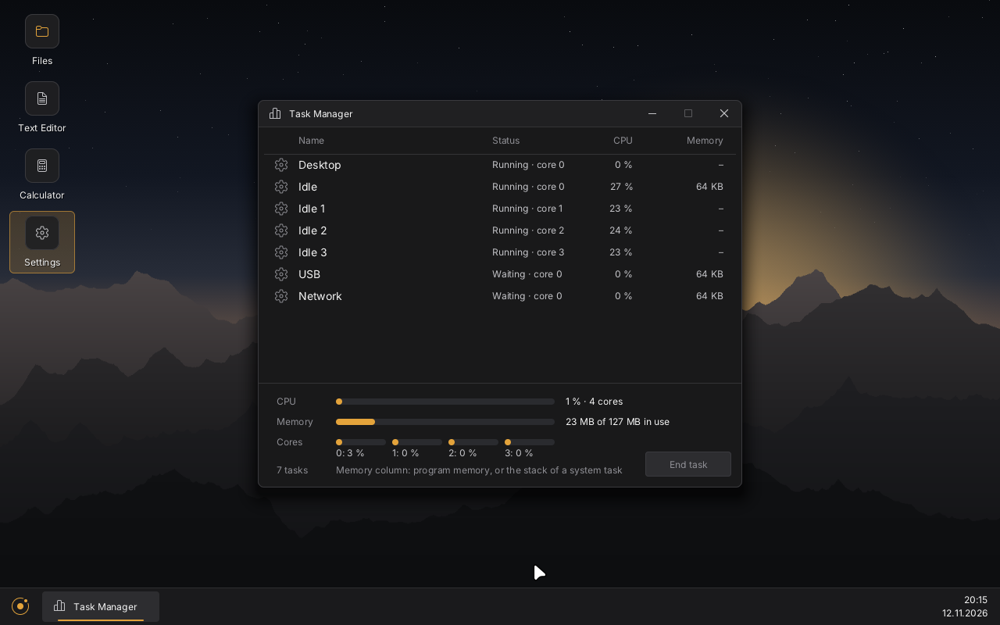

  

<h1 align="center">AstraOS</h1>

  <b>A new operating system with its own kernel – small enough to run in 32 MB of memory.</b> 
  Needs a 64-bit PC (<b>x86-64</b>). 32 MB of RAM minimum, 128 MB recommended for apps.

  <a href="https://astraos.page">🌐 Website</a> ·
  <a href="https://astraos.page/features/">🖼️ Features</a> ·
  <a href="https://astraos.page/download/">⬇️ Download</a> ·
  <a href="https://astraos.page/usage/">📊 Usage</a> ·
  <a href="https://astraos.page/news/">📰 News</a> ·
  <a href="https://astraos.page/faq/">❓ FAQ</a> ·
  <a href="https://astraos.page/de/">🇩🇪 Deutsch</a> 
  Official website: astraos.page only – not related to Astra Linux or astraos.dev.

  
  
  
  

---

## Screenshots

Real screenshots from AstraOS:

| Start menu | Files |
|---|---|
|  |  |
| **Security settings** | **Task Manager** |
|  |  |

## Status

AstraOS is in pre-alpha. The **beta is planned for 1 December 2026 at 20:30** – it opens in a window on Windows with AstraOS Starter, nothing gets installed. Dates can move; we will tell you honestly.

What we are working on right now is on the [News page](https://astraos.page/news/).

---

📬 Contact: **contact@astraos.page** · The kernel source is not public (yet).
