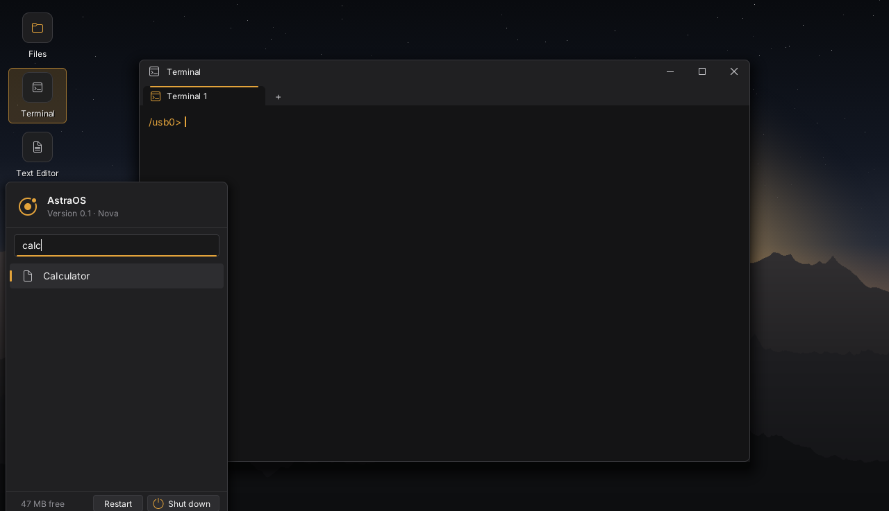
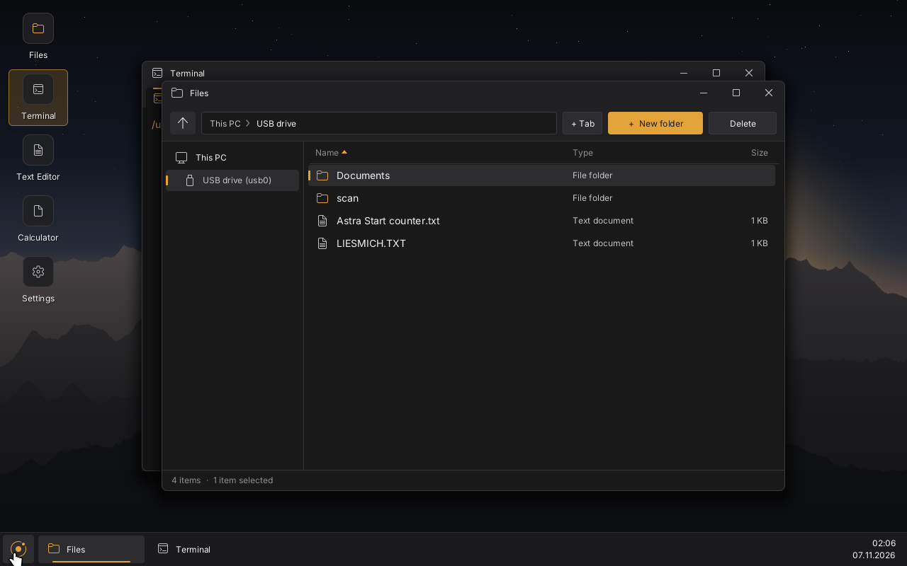
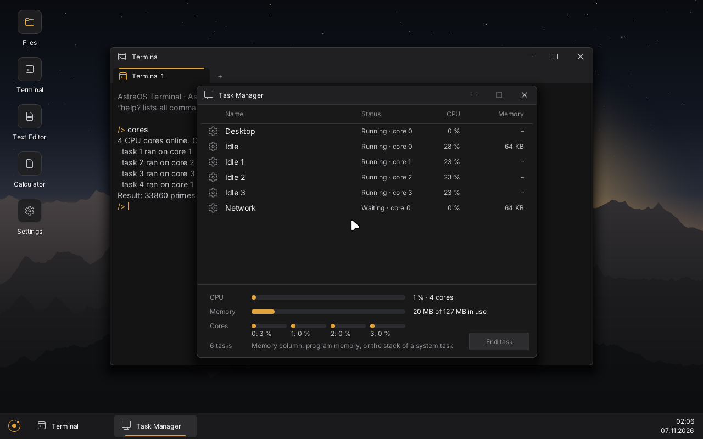
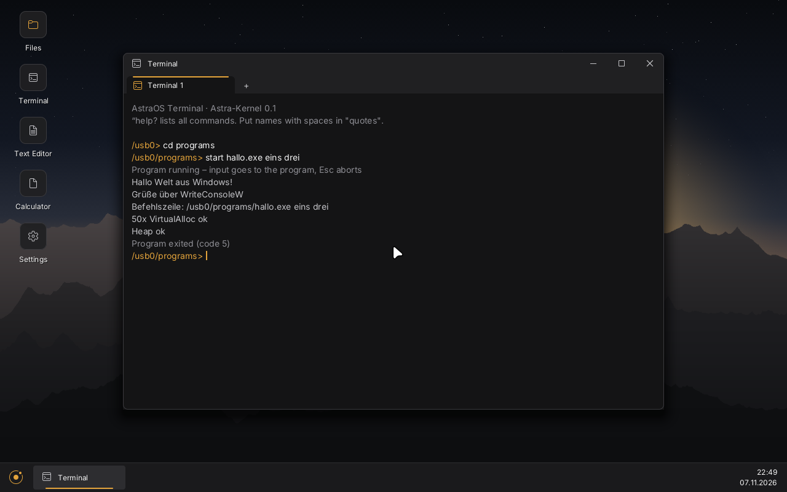
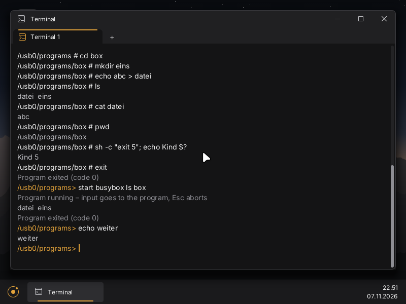

  

<h1 align="center">AstraOS</h1>

  <b>AstraOS is a from-scratch operating system with its own kernel, written from scratch with AI assistants and directed by one person.</b> 
  No Linux inside, no Windows inside. Runs on <b>x86-64</b> and <b>ARM64</b>. Needs only <b>32 MB of RAM</b> (128 MB recommended).

  <a href="https://astraos.page">🌐 Website</a> ·
  <a href="https://astraos.page/download/">⬇️ Download</a> ·
  <a href="https://astraos.page/news/">📰 News</a> ·
  <a href="https://astraos.page/faq/">❓ FAQ</a> ·
  <a href="https://astraos.page/about/">📋 Facts</a> · Official website: astraos.page only – not related to astraos.dev.
  <a href="https://astraos.page/de/">🇩🇪 Deutsch</a>

  
  
  
  

---

## What is AstraOS?

AstraOS is a new desktop operating system. The kernel, the window system and the apps are our own – not a Linux distribution and not a Windows mod.
It is built by AI coding assistants and led by one person who does not write code. Everything we list here is tested on every build; what does not work yet, we say.

Screenshots from our automatic tests (7 November 2026):

| Files | Task Manager, 4 CPU cores |
|---|---|
|  |  |
| **Windows .exe program in the Terminal** | **BusyBox shell on ARM64** |
|  |  |

## What already works (tested)

- 🖥️ **Desktop** with windows (move, resize, minimize, maximize), taskbar and a searchable Start menu
- 📁 **Apps:** Files, Terminal, Text Editor, Calculator, Task Manager, Settings, Web Browser (HTTP)
- 🧠 **Small:** the OS starts and runs in **32 MB of RAM**; 128 MB recommended for apps
- 🔀 **Two CPU families:** boots to the desktop on **x86-64** (BIOS + UEFI) and **ARM64** (UEFI)
- 🪟 **Windows programs:** simple Windows `.exe` programs (console) start from the Terminal or Files
- 🐧 **Linux programs:** Linux ELF programs and the BusyBox shell run on AstraOS – on x86-64 and ARM64
- 📦 **`.aapp` apps:** signed app packages, installed with their own rights
- ⚙️ Several CPU cores, sound, USB keyboard, mouse and USB sticks, network

**Not yet:** HTTPS in the browser, big Windows programs, macOS programs, real-hardware tests – see the [roadmap on the website](https://astraos.page).

## Dates

- **Alpha 0.1:** 10 November 2026
- **Beta:** 1 December 2026

Try it today in a window with the **[AstraOS Starter](https://astraos.page/download/)** (tested on Windows; Linux and macOS versions not tested yet).

## Learn more

[Why AstraOS?](https://astraos.page/why-astraos/) ·
[AstraOS vs Linux vs Windows](https://astraos.page/compare/) ·
[An OS with its own kernel](https://astraos.page/own-kernel-os/) ·
[An OS for 32 MB of RAM](https://astraos.page/64mb-ram-os/) ·
[One OS for ARM64 and x86-64](https://astraos.page/arm64-os/) ·
[Windows and Linux programs](https://astraos.page/windows-linux-apps/) ·
[An OS written by AI](https://astraos.page/ai-built-os/) ·
[A new operating system](https://astraos.page/new-operating-system/)

---

🛡️ Security reports: **security@astraos.page** · The kernel source is not public (yet).
